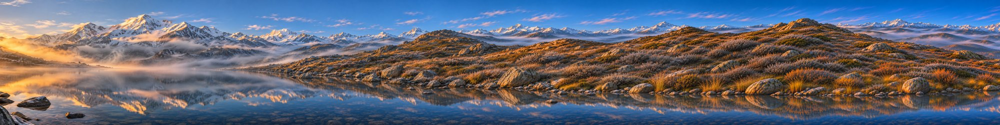

# Wide Image Generator — 突破图片生成宽高比限制

基于 OpenAI 兼容 Image API（gpt-image 系列），通过 **分段生成 + 参考图续接 + 接缝融合**，
生成宽高比超过 3:1 的完整连贯长图（支持 6:1、8:1 及自定义比例）。

## 方案原理

单次 Image API 调用最大只支持 1536x1024（约 3:2），无法直接输出超宽图。
本项目采用"滚动续接"（rolling outpainting）策略：

1. **首块生成**：按目标高度（1024px）生成第一块 1536x1024 的画面，
   提示词中约定整幅长图的主题、风格、光照与镜头视角。
2. **滚动续接**：每次取当前画布最右侧 512px 作为参考图，
   调用 `images/edits`（图生图）让模型"向右无缝延续画面"，
   得到新的 1536x1024 图块。
3. **接缝融合**：新图块与原画布在 512px 重叠区做线性交叉淡化（cross-fade），
   消除接缝色差与错位。
4. **循环裁切**：重复步骤 2-3 直到画布宽度达到目标宽度，最后裁切到精确尺寸。

```
┌────────┬────┐
│ tile 0 │▒▒▒│            ▒ = 512px 重叠融合区
└────────┴───┼────┐
             │tile1│▒▒▒│
             └────┴───┼────┐
                      │tile2│ ...
                      └────┴────┘
```

## 项目结构

```
wide-image-generator/
├── backend/
│   ├── main.py           # FastAPI 服务 + Demo 前端托管
│   ├── pipeline.py       # 分段生成 + 融合核心逻辑
│   └── requirements.txt
├── static/
│   └── index.html        # 在线 Demo 页面
├── examples/             # 6:1 / 8:1 实际生成案例
├── .env.example          # 配置模板（不含真实 Key）
└── README.md
```

## 依赖

- Python 3.10+
- fastapi / uvicorn / httpx / pillow / python-dotenv

```bash
pip install -r backend/requirements.txt
```

## 运行方式

```bash
# 1. 配置环境变量（Key 不会提交到仓库）
cp .env.example .env
#    编辑 .env，填入你的 API_BASE_URL 和 API_KEY

# 2. 启动服务（方式一：命令行）
python run.py

# 3. 打开 Demo
# http://localhost:8000
```

### 用 PyCharm 运行

1. PyCharm → `File → Open` 打开 `wide-image-generator` 文件夹；
2. `Settings → Project → Python Interpreter` 新建或选择一个 Python 3.10+ 解释器，
   终端执行 `pip install -r backend/requirements.txt`（PyCharm 也会自动提示安装依赖）；
3. 直接右键运行根目录的 `run.py`（已内置 uvicorn 启动逻辑，无需配置 Run Configuration）；
4. 控制台输出 `Demo: http://127.0.0.1:8000` 后，按住 Ctrl 点击链接即可打开页面。

命令行直接出图（不开 Web 界面）：

```bash
python backend/cli.py --prompt "未来城市天际线全景，赛博朋克风格" --ratio 8 --out out.png
```

## 在线 Demo

Demo 页面支持：输入提示词 → 选择目标比例（6:1 / 8:1 / 自定义）→ 逐步查看图块生成进度 → 预览并下载最终长图。

## 实际生成案例（examples/samples/）

| 案例 | 比例 | 尺寸 | 耗时 | 文件 |
|---|---|---|---|---|
| 赛博朋克城市天际线 | 6:1 | 6144×1024 | 约 4 分 45 秒（6 次 API 调用） | `6to1_city.png` |
| 雪山湖泊晨雾全景 | 8:1 | 8192×1024 | 约 5 分 30 秒（8 次 API 调用） | `8to1_mountain.png` |
| 丝绸之路商队（附加） | 4:1 | 4096×1024 | 约 2 分 30 秒（4 次 API 调用） | `4to1_silkroad.png` |




原图（PNG 全尺寸）见 `examples/samples/`，`examples/previews/` 为 README 用的压缩预览。

实测环境：中转 API（OpenAI 兼容，`gpt-image-2`），单次生成/编辑调用约 30-60 秒。

## 已知问题与效果限制

- **接缝一致性**：图生图对参考图的还原并非逐像素精确（实测重叠区平均像素差约 5%），重叠区虽经交叉淡化，
  个别情况下仍可能出现细微的结构错位（如山脊线、地砖纹路不连续）或轻微色调跳变。
- **返回尺寸不稳定**：部分中转/模型会忽略请求的 `size` 参数（实测首次生成偶发返回 3:1 的 2172×724），
  项目已通过 `normalize_tile()` 自动居中裁切 + 缩放归一化处理。
- **累计漂移**：块数越多（比例越大），主体风格发生轻微漂移的累积风险越高。
  提示词中固定风格描述可显著缓解。
- **生成耗时**：8:1 实测约 5-6 分钟（8 次 API 调用），6:1 约 4-5 分钟。
- **内容衔接逻辑**：模型对"向右延续"的理解依赖提示词质量，
  复杂构图（如要求某个特定主体横跨整幅画面）可能出现主体重复。
- 本项目不改变单次 API 的尺寸限制，而是通过多次调用在应用层拼合，属于工程绕行方案。

## 安全说明

API Key 仅通过 `.env` / 环境变量读取，`.env` 已加入 `.gitignore`，不会提交到公开仓库。
